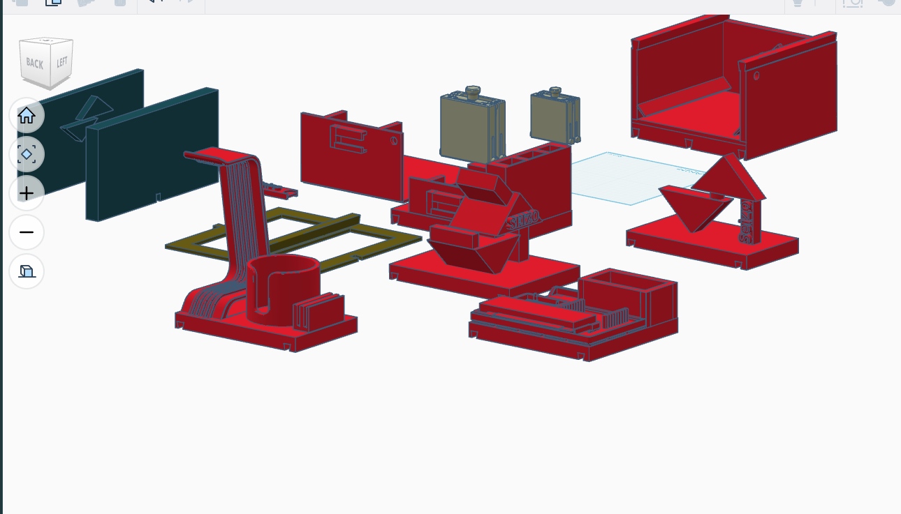
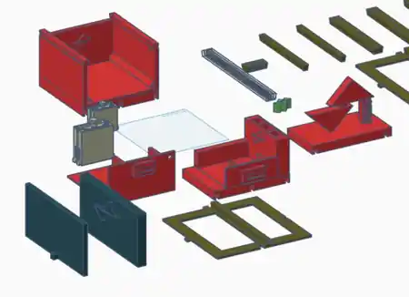

# Seizo Nexus

This is Seizo Nexus. It's a massive modular stackable, sick building-block like holder for most things I have. I have spent a week designing this and a ton of time too. The modules connect by 2 or 1 dovetail connectors depending on the piece. It has a small connectable 4 sided baseplate for connecting parts, sick covers for sides, a big main connector which has 3 walls and a scissor lift to hodl things in place, and a few modules too like a headphone, surge protector, logo, waterbottle, jumper wires, nametags, vertical boxes, small parts, an arduino uno, an arduino nano, and a ton of more unique and nice additions. I knew that a big problem with boxes currently is that they cannot fit and adjust so I made this. I was considering other mechanisms like some steps or a simple push, but I determined that the scissor lift is the best blend of reliability, coolness, and functionality. A lot of inspiration from this came from Legos and Youtube modular boxes too.

## Credits

- Dovetail connectors (edited heavily): [Impossible Dovetail Puzzle Box - Free 3D Print Model - MakerWorld](https://makerworld.com/en/models/518613-impossible-dovetail-puzzle-box?from=search#profileId-434904)
- Scissor lift (also edited heavily): [Lab Jack Print-in-Place](https://makerworld.com/en/models/2766818-lab-jack-print-in-place?from=search#profileId-3072591)
