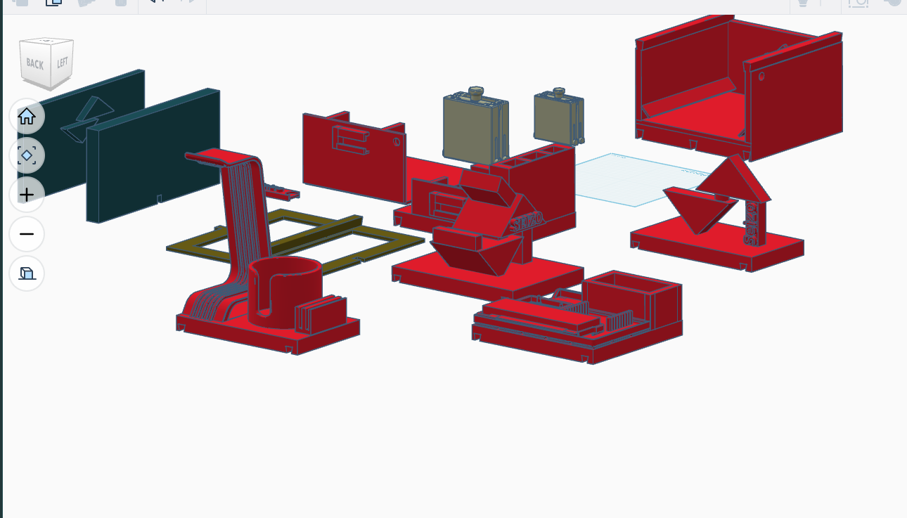

<div align="center">

# Seizo Nexus

### A 3D-printable modular workstation for robotics, tools, and everyday projects.

**Interchangeable storage · Dovetail connections · Custom holders · Seizo identity**

[STL files](models/stl) · [STEP files](models/step) · [Build notes](docs/BUILD_NOTES.md) · [Development journal](JOURNAL.md)

</div>



*The current design arranged in CAD. This is the original project screenshot, not a photograph of a completed printed workstation. It shows the wider design; the download batch below contains four supplied exports, not a verified inventory of every module in the picture.*

## The idea

Seizo Nexus is my modular workstation project, designed around the practical problem of keeping a robotics workspace organized while the project itself keeps changing. Instead of making one fixed box, the design uses separate storage, mounting, holder, and display modules that can be rearranged around the work.

The concept combines interchangeable drawers, dovetail-connected bases, adjustable holding mechanisms, shelf covers, removable labels, and a large Seizo logo. The aim is a useful system for my robotic-arm project that can also organize tools and other everyday items.

**Designed by Vivaan Goel.** The design work is documented through [Hack Club Half Life](https://halflife.hackclub.com/projects/cmv5u1dte0krq01n05qgxulbm). The main CAD work was done in Tinkercad. Third-party source models are involved in parts of the design; see [Attribution and licensing](#attribution-and-licensing).

> [!IMPORTANT]
> This is a CAD prototype and file release. The four original STL exports and four converted STEP files are available. Digital geometry checks passed, but print fit, assembly clearances, holding force, and load capacity have not been established by those checks.

## Contents

- [What makes it modular](#what-makes-it-modular)
- [Modules and design features](#modules-and-design-features)
- [Download the CAD files](#download-the-cad-files)
- [What the STEP conversion contains](#what-the-step-conversion-contains)
- [Before printing](#before-printing)
- [Repository layout](#repository-layout)
- [Design journey](#design-journey)
- [Build status and next milestones](#build-status-and-next-milestones)
- [Attribution and licensing](#attribution-and-licensing)

## What makes it modular

**A shared connection approach.** Dovetail features are intended to connect the storage and base modules without redesigning the entire workstation whenever the layout changes.

**Separate containers and holders.** Drawers, bases, covers, and accessory modules have different jobs. A smaller holder can serve a compact item while a larger enclosure provides storage. The project is not limited to one container size.

**Adjustable retention.** The design moved away from an early two-lead-screw idea toward a sideways scissor mechanism. That mechanism is intended to help hold different-sized contents between side panels. Its fit and range still need to be checked in printed parts.

**Replaceable identification.** Slide-on logo elements and a modular name-tag section make the workstation recognizable without requiring the whole structure to be remade for a different label.

These are the design intentions recorded in the [journal](JOURNAL.md). They are not claims of a tested universal connector standard or measured mechanical performance.

## Modules and design features

| Module or feature | Intended role | Current evidence |
| --- | --- | --- |
| Drawer and enclosure system | Interchangeable storage with side panels and different box sizes | CAD work described in the journal and visible in the overview |
| Dovetail-connected base holder | Connect and arrange the storage modules | Base-holder design and stacking concept documented on October 14 |
| Compact surge-protector holder | Organize an existing enclosed power strip and nearby small items | Smaller holder described in the journal; electrical internals are not part of this project |
| Organizer and accessory modules | Give commonly used items a dedicated place | Three additional modules documented on October 16 |
| Slide-on Seizo logo and display stand | Removable project identification and display | Logo/stand work documented and shown in the CAD overview |
| Modular name-tag section | Change the label without replacing the main module | Described in the October 16 development entry |
| Shelf covers and attachment holes | Cover storage areas and provide attachment points | Later design additions documented in the journal |

An earlier padlock-style locking concept was abandoned because it did not fit the design. It is not presented here as a working feature. Optional adhesive silicone feet were considered, but are not confirmed purchased components.

## Download the CAD files

**Use the STL files for slicing. Use the STEP files for CAD import, measurement, and placement.** Each STEP has the same filename stem as its source STL. The original names are deliberately preserved because a verified module-to-file naming map has not yet been supplied.

| Export | Original STL | Converted STEP | Overall X × Y × Z* | Separate solids |
| --- | --- | --- | --- | ---: |
| 01 | [Seizo Nexus.stl](models/stl/Seizo%20Nexus.stl) | [Seizo Nexus.step](models/step/Seizo%20Nexus.step) | 200.000 × 200.038 × 138.397 | 1 |
| 02 | [Seizo Nexus (1).stl](models/stl/Seizo%20Nexus%20%281%29.stl) | [Seizo Nexus (1).step](models/step/Seizo%20Nexus%20%281%29.step) | 261.000 × 263.400 × 17.000 | 1 |
| 03 | [Seizo Nexus (2).stl](models/stl/Seizo%20Nexus%20%282%29.stl) | [Seizo Nexus (2).step](models/step/Seizo%20Nexus%20%282%29.step) | 210.191 × 270.163 × 99.000 | 8 |
| 04 | [Seizo Nexus (3).stl](models/stl/Seizo%20Nexus%20%283%29.stl) | [Seizo Nexus (3).step](models/step/Seizo%20Nexus%20%283%29.step) | 200.001 × 157.179 × 112.100 | 2 |

*Dimensions are in **millimetres under the assumption that one STL coordinate unit equals one millimetre**. STL does not declare units. These are file bounding-box dimensions, not independently measured physical dimensions, per-part sizes, or recommended print orientations. For multi-body exports, they describe the whole supplied layout.*

The batch contains **4,274 original triangles and 12 disconnected closed components** across the four exports. The STEP conversion keeps those components as 12 separate solids. A disconnected component is a geometric count, not a verified count of functional modules or required print quantities.

Original STL bytes, coordinates, and scale are preserved. No automatic centering, resizing, mesh decimation, hole filling, or union of separate components was applied. Some exports retain CAD-layout positions away from the origin.

For full measurements, checksums, and component-level checks, see the [geometry validation report](docs/geometry-validation.json) and [conversion notes](docs/STEP_CONVERSION.md).

## What the STEP conversion contains

The STEP files are **mesh-derived, faceted boundary-representation solids**. Each original triangle becomes a planar face. Faces are sewn into a closed shell, converted into an oriented solid, and exported. Separate source components remain separate solids in a compound.

They are real STEP geometry, not STL files with a different extension. Each file was reopened with the CAD kernel and checked for valid solids, matching body counts, matching bounds, and matching surface area and volume within the documented tolerances.

**The conversion does not recover the original CAD design history.** Sketches, dimensions, feature trees, constraints, exact circles, and original curved surfaces cannot be reconstructed merely by changing file format. Curves remain faceted at the source mesh resolution. Direct CAD edits may be possible, but these files should not be described as the original parametric source.

For substantial redesign, the original modeling project is preferable. For a faithful neutral-format version of the supplied exports, use these STEP files. The [conversion script](tools/convert_stl_to_step.py) and [pinned dependencies](tools/requirements-cad.txt) are included so the process can be reproduced.

## Before printing

1. **Check units and the build volume.** Inspect the imported size before slicing. Export 02 is approximately 261 × 263 mm in its current XY orientation. Export 03 spans approximately 270 mm along Y. Neither should be assumed to fit a 256 mm square bed as currently laid out. Reorientation or separating appropriate bodies may help; shrinking everything changes connector fit.
2. **Inspect each export rather than treating the screenshot as a print plate.** Multi-body files may contain parts intended to be handled separately. Confirm which bodies belong together, and check for overlaps, duplicates, trapped pieces, and unsupported regions in the slicer.
3. **Test the mating features first.** Check dovetail fit, drawer travel, cover clearance, and scissor-mechanism movement before committing to a full assembly. This release does not specify validated dimensional clearances, layer heights, infill, support settings, or hardware quantities.
4. **Keep moving and electrical areas accessible.** Avoid pinch points around the scissor mechanism. Do not modify a power strip's mains wiring or enclosure to make it fit. Keep its switch, cord exits, ventilation, and plug access clear. Nexus is a mechanical holder, not an electrical enclosure certification.

The [build notes](docs/BUILD_NOTES.md) explain the remaining checks. Do not interpret digital watertightness as proof that a print is strong enough, that every component fits, or that an assembled mechanism operates safely.

## Repository layout

```text
Seizo-Nexus/
├── README.md                       Project overview and downloads
├── JOURNAL.md                      Half Life development log, synced externally
├── BOM.csv                         Existing bill-of-materials placeholder
├── ATTRIBUTION.md                  Third-party model and licensing status
├── models/
│   ├── stl/                        Four unchanged source exports
│   └── step/                       Four converted faceted STEP files
├── docs/
│   ├── images/seizo-nexus-overview.png
│   ├── BUILD_NOTES.md
│   ├── STEP_CONVERSION.md
│   └── geometry-validation.json     Machine-readable conversion evidence
└── tools/
    ├── source-manifest.json         Source identities and expected counts
    ├── convert_stl_to_step.py       Reproducible conversion
    ├── validate_release.py          Independent file and geometry checks
    └── requirements-cad.txt
```

`JOURNAL.md` is generated by Half Life. Changes to that file should be made on the platform rather than in this repository because the next sync overwrites the mirrored copy.

`BOM.csv` is still a placeholder. Its zero-dollar shipping row is **not a verified total project cost**. Print material, quantities, fastening details, purchased components, shipping, and taxes have not been priced in this release.

## Design journey

The [full journal](JOURNAL.md) contains screenshots and the working notes behind the design. At the October 16, 2026 snapshot, it reports **25 hours across six entries, Week 2 / Tier 2**.

| Date | Journal-reported time | Design progress |
| --- | ---: | --- |
| October 12 | 5 hours | Explored lead-screw approaches, changed to a sideways scissor concept, and developed the drawer/dovetail arrangement |
| October 14 | 2 hours | Developed the modular base holder and connection approach |
| October 14 | 3 hours | Designed the smaller surge-protector holder |
| October 16 | 5 hours | Added Seizo branding, slide-on logo display, modular labels, and refinements |
| October 16 | 4 hours | Replaced the padlock concept with covers and added attachment holes |
| October 16 | 6 hours | Developed three additional organizer modules |

These are the project's recorded design hours, not physical fabrication or testing hours inferred from the CAD screenshot.

## Build status and next milestones

**Available now:** the overview image, documented concept and development history, four source STL files, four converted STEP files, and reproducible digital geometry checks.

**Still to validate:** the precise mapping from files to functional modules, printed connector tolerances, print orientation and support strategy, drawer and scissor travel, assembled stability, material choice, and useful load capacity. The wider screenshot has not been reconciled against a complete downloadable parts inventory.

**Still to document:** the final BOM, original editable CAD source, physical assembly photographs, and the exact source/creator/license for reused or modified models.

Seizo Nexus is the workstation around the robotics project. It is separate from the arm's control software, electronics HAT, and AI training. Publishing these CAD files does not alter or enable any robot motion.

## Attribution and licensing

The development journal explicitly identifies a pre-existing **MakerWorld scissor-lift model** and mentions researching and modifying other models for later modules. The exact model pages, creators, and applicable licenses have not yet been recorded. Those gaps are documented in [ATTRIBUTION.md](ATTRIBUTION.md), not silently replaced with invented credits.

No repository-wide reuse license has been selected in this release. Do not assume that public availability grants permission to relicense every component or that every shape was created from scratch. Any later license must respect the source terms of reused material.

To suggest an improvement, open an issue with the export filename, the affected part, its measured dimensions, and a screenshot or photo. Physical fit results are particularly useful because they turn the current CAD assumptions into tested build information.

---

**Seizo Nexus** · Vivaan Goel · CAD export batch documented October 16, 2026
