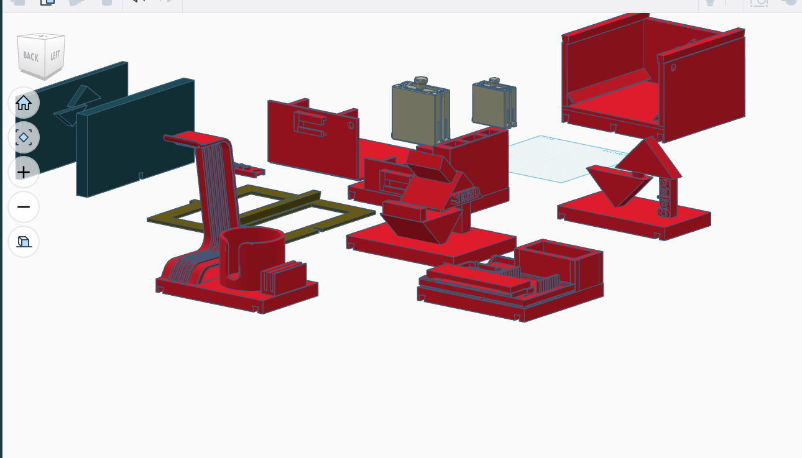
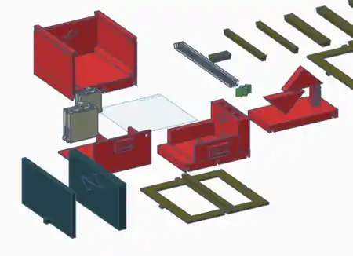

# Seizo Nexus

This is Seizo Nexus. It's a massive modular stackable, sick building-block like holder for most things I have. I have spent a week designing this and a ton of time too. The modules connect by 2 or 1 dovetail connectors depending on the piece. It has a small connectable 4 sided baseplate for connecting parts, sick covers for sides, a big main connector which has 3 walls and a scissor lift to hodl things in place, and a few modules too like a headphone, surge protector, logo, waterbottle, jumper wires, nametags, vertical boxes, small parts, an arduino uno, an arduino nano, and a ton of more unique and nice additions. I knew that a big problem with boxes currently is that they cannot fit and adjust so I made this. I was considering other mechanisms like some steps or a simple push, but I determined that the scissor lift is the best blend of reliability, coolness, and functionality. A lot of inspiration from this came from Legos and Youtube modular boxes too.

## CAD files

- [Original Fusion source (.f3d)](models/Seizo%20Nexus.f3d)
- [Original STEP part exports](models/step/)
- [Original STL part exports](models/stl/)

**Hack Club review target: Tier 2.** [Historical journal](JOURNAL.md).

## Bill of materials

Prices checked **2026-11-24**, in USD. **Tax is excluded and will be added later.**

| Part | Qty | Unit price (USD) | Total (USD) | Buying link |
| --- | ---: | ---: | ---: | --- |
| Anycubic PLA+ Refill, black, 1.75 mm, 1 kg | 1 | $17.99 | $17.99 | [Exact refill variant](https://us.anycubic3d.com/products/pla-plus-refill?variant=52971853709631) |
| Siraya Tech Flex TPU Air 85A, white, 1.75 mm, 1 kg, US stock | 1 | $42.99 | $42.99 | [Exact TPU variant](https://siraya.tech/products/flex-tpu-air-65a-82a-foaming-flexible-filament?variant=42692714627181) |
| Anycubic mainland US shipping | 1 | $0.00 | $0.00 | [Shipping policy](https://us.anycubic3d.com/pages/shipping-policy) |
| Siraya Tech US non-remote shipping | 1 | $0.00 | $0.00 | [Shipping policy](https://siraya.tech/policies/shipping-policy) |
| **Subtotal excluding tax** | | | **$60.98** | |

Material quantity: **one refill and one spool, 2 kg total**. The refill requires a compatible reusable spool; a new spool is not included in this budget.

The TPU Air's stated printed hardness is approximately **65A–82A**, depending on foaming settings. Its starting grade is 85A. Approximately 65A requires 270°C and calibrated flow according to the manufacturer. Compatibility with the intended printer has not been established.

Tier 2's $65 grant leaves **$4.02 before tax or any extra charges**. The final funded total remains pending. Shipping uses the sellers' published US policies, not a checkout quote. Filament quantity is a purchase plan, not a verified sliced consumption figure.

[BOM.csv](BOM.csv) contains the itemized budget. [Price verification](docs/filament-price-check.json) records variants, stock, minimum quantities, shipping sources, and material requirements.

## Credits

- Dovetail connectors (edited heavily): [Impossible Dovetail Puzzle Box - Free 3D Print Model - MakerWorld](https://makerworld.com/en/models/518613-impossible-dovetail-puzzle-box?from=search#profileId-434904)
- Scissor lift (also edited heavily): [Lab Jack Print-in-Place](https://makerworld.com/en/models/2766818-lab-jack-print-in-place?from=search#profileId-3072591)
