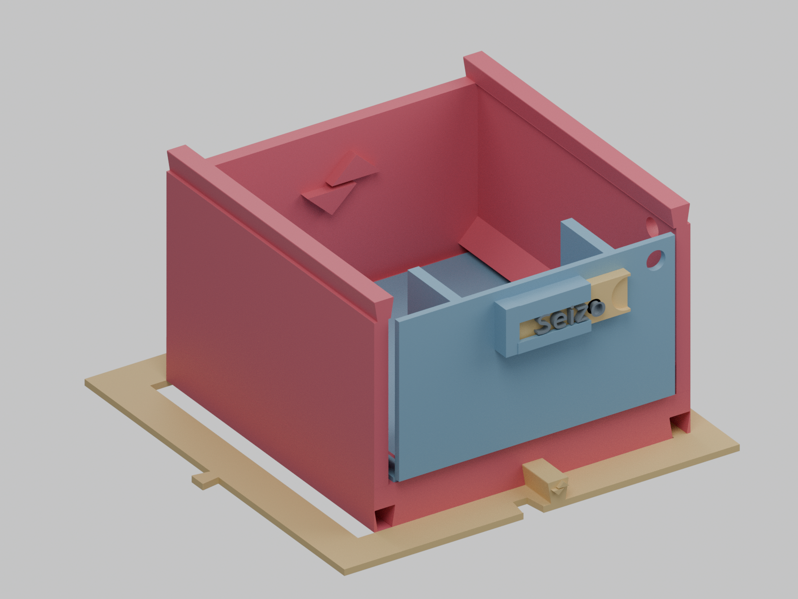
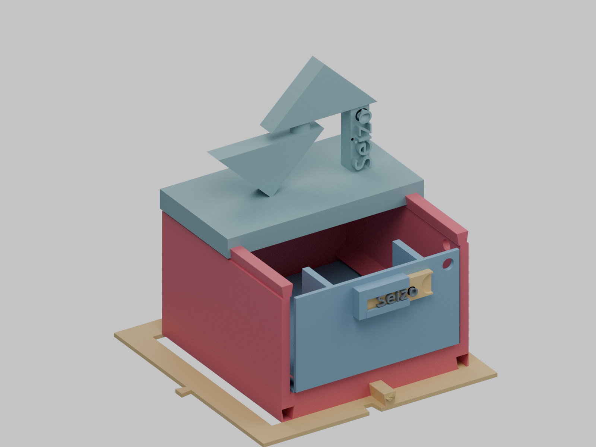

# Seizo Nexus

Seizo Nexus is a modular desk organizer with a Fusion F3D source file. The assembled configuration below shows how the base, U-shaped shell with rails, sliding drawer, and front Seizo badge fit together.

## CAD files and assembly

| File | Purpose |
| --- | --- |
| [Assembled model (.step)](models/assembled/Seizo_Nexus_Assembled.step) | Review the desk organizer with its parts placed together. |
| [Stacked example (.step)](models/assembled/Seizo_Nexus_Stacked_Example.step) | The same assembly with a Seizo logo display seated on its upper rails. |
| [Original Fusion design (.f3d)](models/Seizo%20Nexus.f3d) | Genuine Fusion source document, retained in its original form. |
| [Assembly notes](docs/ASSEMBLY.md) | Component placement, source provenance, and validation details. |
| [Original STEP exports](models/step/) and [STL exports](models/stl/) | Separate source exports retained for reference. |

The assembled STEP files are produced from the boundary representation in the genuine F3D source. The original Fusion document remains the source; the new assembled deliverables are the STEP files linked above. These review poses retain small source interferences at the dovetails and badge, detailed in the assembly notes. Physical print fit has not been verified.

**Hack Club target: Tier 2**, following the review feedback. The existing [journal](JOURNAL.md) is preserved as a historical record. This revision adds no time-tracking or timelapse evidence.

## Bill of materials

Prices checked **2026-11-24**, in USD. The filament link selects the **black 1 kg spool** at the listed unit price.

| Part | Qty | Unit price (USD) | Total (USD) | Buying link |
| --- | ---: | ---: | ---: | --- |
| Anycubic PLA Basic, black, 1.75 mm, 1 kg spool | 2 | $17.99 | $35.98 | [Exact Anycubic variant](https://us.anycubic3d.com/products/pla-filament?variant=52972680151359) |
| Shipping to mainland USA | 1 | $0.00 | $0.00 | [Anycubic shipping policy](https://us.anycubic3d.com/pages/shipping-policy) |
| Estimated sales tax, Dublin CA, 10.25% | 1 | $3.69 | $3.69 | [California tax rates](https://cdtfa.ca.gov/taxes-and-fees/rates.aspx) |
| **Estimated order total** | | | **$39.67** | |

The two rolls are a **2 kg purchase budget cap**. Filament consumption for this assembly has not been measured in a slicer. CAD display colors identify components and do not require multiple filament colors. Sales tax is an estimate for Dublin, California; the final charge is determined at checkout.

The machine-readable budget is in [BOM.csv](BOM.csv). The [price check](docs/filament-price-check.json) records the exact variant, minimum order quantity of one, and calculation sources.

## Optional modules and source overview

The broader source design explores a stackable, building-block-style organizer with one or two dovetail connections per module. It includes a four-sided baseplate, side covers, a three-wall connector, and a scissor-lift concept for adjustable storage. Optional holders cover headphones, a surge protector, a water bottle, jumper wires, name tags, vertical boxes, small parts, Arduino Uno and Nano boards, and logo displays. The original inspiration came from LEGO and modular-box projects on YouTube.

These original overview images show the wider collection of source parts. The assembled desk-organizer configuration is shown at the top of this page.

## Credits

- Dovetail connectors (edited heavily): [Impossible Dovetail Puzzle Box - Free 3D Print Model - MakerWorld](https://makerworld.com/en/models/518613-impossible-dovetail-puzzle-box?from=search#profileId-434904)
- Scissor lift (also edited heavily): [Lab Jack Print-in-Place](https://makerworld.com/en/models/2766818-lab-jack-print-in-place?from=search#profileId-3072591)
