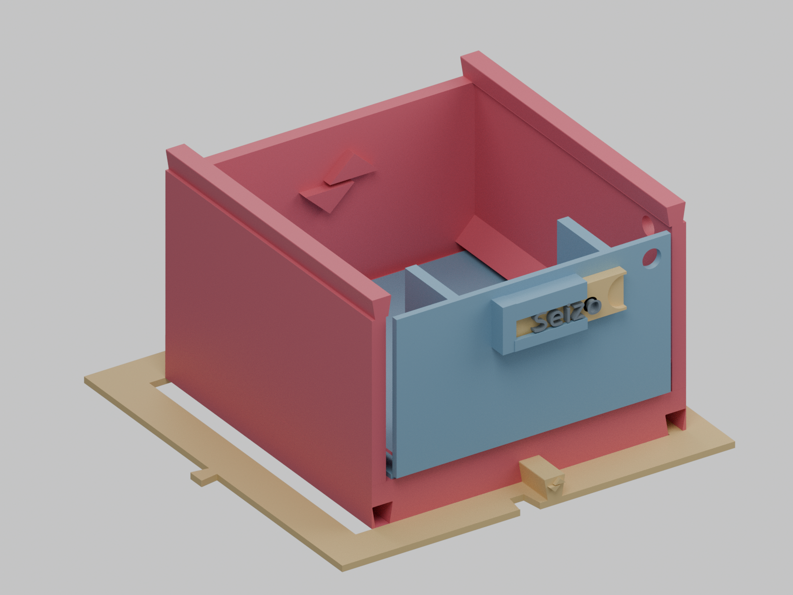
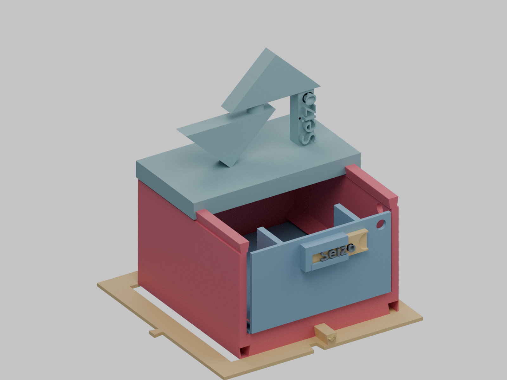

# Seizo Nexus assembly review

The new STEP files show the parts placed together, using geometry recovered from the existing [Fusion F3D source](../models/Seizo%20Nexus.f3d).

| Model | Contents | Valid solids | Overall size, mm |
| --- | --- | ---: | --- |
| [Assembled organizer](../models/assembled/Seizo_Nexus_Assembled.step) | Base, shell and rails, sliding drawer, front badge | 16 | 261.00 × 263.40 × 142.40 |
| [Stacked example](../models/assembled/Seizo_Nexus_Stacked_Example.step) | Assembled organizer plus the Seizo logo display | 17 | 261.00 × 263.40 × 271.99 |

The STEP hierarchy names the component groups. Display colors distinguish them; both budgeted filament spools are black. The original F3D and original STL/STEP exports are retained.

## How the parts connect

1. The base's long central dovetail enters the channel under the U-shaped shell.
2. The drawer rests on the shell's inner floor. Its lower tray runs beneath the shell's retaining lips, with the drawer front outside the opening.
3. The badge enters the drawer-front holder from its open end. The selected pose shows the plate near the closed stop, with lettering facing outward.
4. In the stacked example, the logo display's two underside channels engage the shell's two top rails.





The broader source contains alternative modules. These two configurations demonstrate the base, drawer, badge, and stacking connections. They do not place every optional part in one stack. The source scissor-lift concept is not represented by validated recovered geometry in these assembly exports.

## Fit findings

These are assembled review models. Physical print fit remains unverified. The source shapes were retained. The following small interferences remain in the assembled poses.

| Interface | CAD result |
| --- | --- |
| Drawer and shell | Zero solid intersection; the drawer rests on the inner floor. |
| Drawer and base | Zero solid intersection; minimum distance is 13 mm. |
| Base dovetail and shell | 11.883 mm³ intersection at the dovetail interface. |
| Badge and drawer holder | 25.214 mm³ intersection including lettering. The plate is 23 mm tall; the holder gap at the inspected center section is approximately 22.9368 mm. |
| Logo display and shell rails | 14.795 mm³ combined intersection with the two rails. The logo display has no intersection with the main shell body. |

The badge clears the holder's closed stop by approximately 0.292 mm. The logo display's measured channel-center spacing is approximately 187.3146 mm, compared with 187.3 mm between the shell rails. Some recovered adjoining source bodies also retain gaps of approximately 0.00006–0.0021 mm.

These findings require a clearance adjustment or a small printed fit sample before relying on the connections in a full print. The CAD review does not establish load capacity, sliding force, or print tolerances. The two-roll BOM is a purchase limit; no slicer measurement of this assembly's filament consumption is claimed.

## Source and export checks

Source document: `models/Seizo Nexus.f3d`, 23,878,687 bytes. Its SHA-256 is:

```text
9850c6f0d920e2db124db5bf80b20034f9c94e988b11db9f85f9a780f22ddf52
```

The F3D archive's native ASM boundary-representation bodies were read using [InventorLoader](https://github.com/jmplonka/InventorLoader) at commit `e94bdf5e29052a0dc7ce6fdf755e956ae507caec`, then converted through FreeCAD/OpenCascade into closed solids. The selected bodies represent the current parts; duplicate history bodies and boolean cutters were excluded. A local rational B-spline serialization correction was needed for the badge lettering. The exported models preserve source surfaces and use rigid rotations/translations to assemble them.

The unit interpretation was calibrated against the original exports. An importer scale of 10 reproduces the 200 mm shell width, 261 mm base width, and 174.382 mm drawer width. Using the history payload's scale value of 50 produced dimensions five times larger. This calibration is recorded in the validation data.

Both final STEP files were independently reopened. All 16 and 17 solids are valid. The sum of body volumes changes by less than 0.000001% across export and reimport. This check confirms the exported geometry; it does not remove the interferences listed above or recover a Fusion feature timeline.

The original Fusion document is unchanged. The new assembled files are STEP exports, not newly saved native F3D documents.

### Placement record

The shell remains in its original coordinate system. Translations are in millimetres.

| Group | Translation X, Y, Z | Rotation applied first |
| --- | --- | --- |
| Shell and upper rails | 0, 0, 0 | None |
| Base | −103.75, −831.419, −4 | None |
| Drawer and its holder | −218, −468, 26 | None |
| Badge plate and lettering | −323, −180.4, 459.277566 | −90° about global X through the origin |
| Optional logo display | 352.3, −539, 128.9865 | None |

Detailed source-body identifiers, transforms, exported-file hashes, validity results, and interference measurements are in [assembly-validation.json](../tools/assembly-validation.json).

## Review scope

This revision addresses the request for an assembled CAD view and a BOM limited to two filament rolls. Tier 2 is the resubmission target stated in the README. The original journal remains a historical record; no additional hours or timelapse evidence were added.
